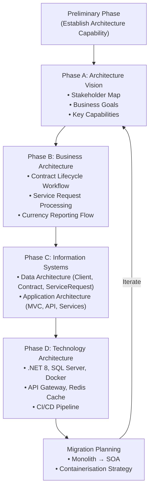
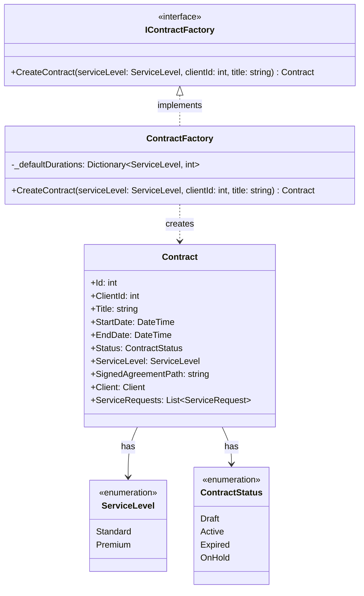
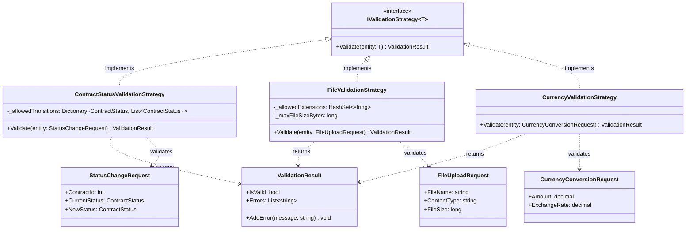
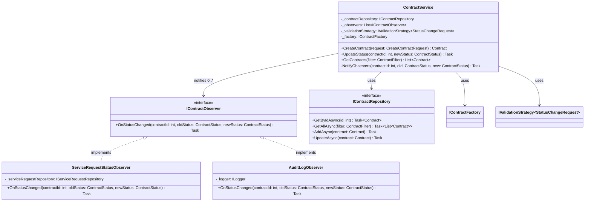
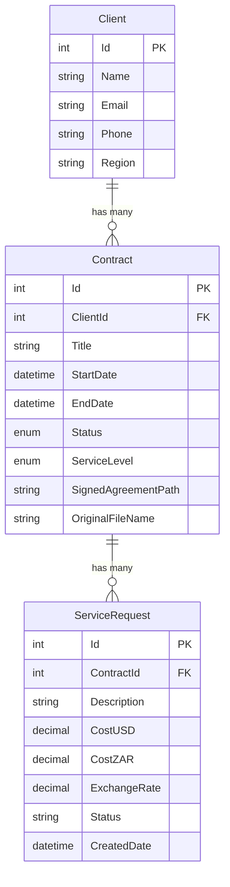
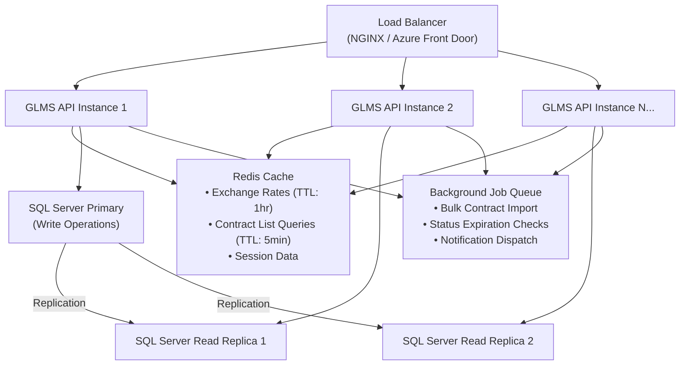

# Global Logistics Management System (GLMS) — Enterprise Analysis & Architecture Report

## 1. Executive Summary & Introduction

TechMove Logistics currently operates on a fragmented legacy infrastructure comprising disconnected spreadsheets, email threads, and manual phone coordination. This antiquated approach has led to severe operational failures: lost invoices, data fragmentation across departments, compliance breaches from expired contracts going undetected, and significant workflow bottlenecks that hinder the company's ability to scale internationally.

The **Global Logistics Management System (GLMS)** is the proposed enterprise-grade solution designed to unify TechMove's contract management, service request processing, and financial reporting into a single, scalable platform. This report presents the architectural vision to the Board of Directors, detailing the enterprise framework strategy, the design patterns that will govern the system's internal structure, and the scalability strategies that will ensure the platform can absorb rapid growth — including the potential overnight onboarding of 50,000 new contracts following a competitor acquisition.

**Scope**: The GLMS will be delivered in three phases — an architecture blueprint (this document), a functional monolithic prototype with automated testing, and a modernised containerised deployment using service-oriented architecture.

**Target Audience**: TechMove Board of Directors, CTO Office, IT Operations.

---

## 2. Enterprise Architecture Framework Strategy — TOGAF ADM

### 2.1 Framework Selection: Why TOGAF?

The Open Group Architecture Framework (TOGAF) was selected over the Zachman Framework for several strategic reasons specific to TechMove's situation:

1. **Process-Oriented Delivery**: TOGAF's Architecture Development Method (ADM) provides a step-by-step, iterative cycle that aligns naturally with the phased delivery model (Prototype → Modernisation → Containerisation). Zachman's static matrix, while comprehensive for classification, does not prescribe a delivery methodology (The Open Group, 2018).

2. **Stakeholder-Centric**: TOGAF explicitly addresses stakeholder concerns at each phase, which is critical when presenting to a Board that needs to understand how technology decisions map to business outcomes.

3. **Logistics Industry Fit**: Global logistics companies operate in rapidly evolving regulatory and operational environments. TOGAF's iterative ADM cycle allows the architecture to evolve as TechMove acquires new clients, enters new markets, or absorbs competitor operations — without requiring a complete re-architecture.

4. **Industry Adoption**: TOGAF is the most widely adopted enterprise architecture framework globally, with extensive tooling support and a mature community of practice (Lankhorst, 2017).

### 2.2 TOGAF ADM Cycle — Applied to TechMove GLMS

The Architecture Development Method (ADM) is the core engine of TOGAF. Below, Phases A through D are applied specifically to the TechMove GLMS project.

**Phase A — Architecture Vision**: The primary stakeholders are TechMove's logistics managers (who raise service requests), the finance team (who need ZAR-denominated reporting), and the compliance officers (who must ensure contracts are tracked and not allowed to lapse). The vision establishes the GLMS as a centralised hub replacing all spreadsheet and email-based workflows. Key capabilities include: automated contract status tracking, validated service request processing, and real-time currency conversion.

**Phase B — Business Architecture**: The core business process is the **Contract Lifecycle**: a contract is created in Draft status, activated upon client agreement, and transitions to Expired when the end date passes or On Hold when disputes arise. Service requests can only be raised against Active contracts — this is the fundamental business rule that the legacy system could not enforce. The freight coordination workflow links clients to contracts to service requests in a strict hierarchy.

**Phase C — Information Systems Architecture**: The data architecture comprises three primary entities — Client, Contract, and ServiceRequest — with one-to-many relationships forming the data backbone. The application architecture separates concerns into a Presentation Layer (ASP.NET Core MVC), a Business Logic Layer (Services implementing design patterns), and a Data Access Layer (Entity Framework Core with Repository pattern). This separation enables the Phase 3 transition from monolith to service-oriented architecture.

**Phase D — Technology Architecture**: The technology stack is selected for enterprise-grade reliability: ASP.NET Core 8 for cross-platform performance, SQL Server for ACID-compliant relational data, Docker for environment consistency, and Redis for caching frequently accessed data (exchange rates, contract lists). The deployment architecture supports horizontal scaling through containerised API instances behind a load balancer.

---

## 3. Design Pattern Selection & Justification

Three Gang of Four (GoF) design patterns have been selected based on their direct applicability to TechMove's domain challenges. Each pattern addresses a specific architectural concern that would otherwise create tight coupling, code duplication, or maintenance difficulties.

### 3.1 Factory Method Pattern

**Pattern Category**: Creational

**Problem It Solves**: TechMove handles multiple contract types — Standard freight agreements, Premium SLA-backed contracts, and Expedited service contracts. Each type requires different initial configurations: default service levels, validation rules, and status transition policies. Without a Factory, the creation logic would be scattered across controllers and tightly coupled to concrete implementations.

**TechMove Application**: The `IContractFactory` interface defines a `CreateContract()` method. Concrete factory implementations (`StandardContractFactory`, `PremiumContractFactory`) encapsulate the specific initialisation logic for each contract type. When TechMove adds a new contract category (e.g., "Hazardous Materials"), a new factory class is created without modifying any existing code — adhering to the Open/Closed Principle.

**Key Classes**: `IContractFactory` (interface), `ContractFactory` (concrete factory with service-level-based creation), `Contract` (product), `ContractService` (consumer).

### 3.2 Strategy Pattern

**Pattern Category**: Behavioural

**Problem It Solves**: The GLMS requires multiple validation contexts — validating contract status transitions, validating uploaded file types, and validating currency conversion inputs. Hard-coding these rules into controllers would create a monolithic validation block that is impossible to test in isolation and difficult to extend.

**TechMove Application**: The `IValidationStrategy` interface defines a `Validate()` method returning a `ValidationResult`. Three concrete strategies implement domain-specific rules:
- `ContractStatusValidationStrategy`: Enforces that service requests can only be created against Active contracts, and that status transitions follow the permitted state machine (Draft→Active→Expired, Active↔OnHold).
- `FileValidationStrategy`: Ensures uploaded files are PDF format only, with appropriate size limits.
- `CurrencyValidationStrategy`: Validates that cost amounts are positive and exchange rates are within reasonable bounds.

The `ContractService` accepts the appropriate strategy via dependency injection, making the validation logic interchangeable and independently testable.

### 3.3 Observer Pattern

**Pattern Category**: Behavioural

**Problem It Solves**: When a contract's status changes (e.g., from Active to Expired), multiple downstream actions must occur: all pending service requests under that contract must be flagged, notifications may need to be triggered, and audit logs must be updated. Without the Observer pattern, the contract status update method would need direct knowledge of every dependent system — creating tight coupling.

**TechMove Application**: The `IContractObserver` interface defines an `OnStatusChanged()` method. The `ContractService` maintains a list of observers and notifies all of them when a status transition occurs. The `ServiceRequestStatusObserver` listens for contract status changes and automatically updates the status of linked service requests (e.g., marking pending requests as "Cancelled" when a contract expires). This decoupling means new observers (e.g., an email notification observer, an audit log observer) can be added without modifying the `ContractService`.

---

## 4. Design Patterns — Logic & Structure

### 4.1 Factory Method — Technical Implementation

The Factory Method pattern is implemented through an interface-based approach where the `ContractFactory` class serves as the central creation point. The factory method `CreateContract` accepts a `ServiceLevel` enum parameter and returns a fully initialised `Contract` entity with the correct default values for that service tier. Internally, the factory uses a switch expression to select the appropriate configuration:

- **Standard**: Default 30-day duration, basic SLA terms, Draft status.
- **Premium**: Default 90-day duration, enhanced SLA with guaranteed response times, Draft status.

The factory is registered as a scoped service in the DI container, allowing controllers and services to request `IContractFactory` without knowledge of the concrete implementation. This enables unit testing with mock factories that return predictable contract instances.

### 4.2 Strategy — Technical Implementation

The Strategy pattern is implemented with a generic `IValidationStrategy<T>` interface to support type-safe validation across different entity types. Each concrete strategy encapsulates a complete set of validation rules and returns a `ValidationResult` object containing success/failure status and a list of error messages.

The `ContractStatusValidationStrategy` maintains an internal dictionary mapping each status to its permitted transitions (e.g., `Draft` can transition to `Active` only, `Active` can transition to `Expired` or `OnHold`). This makes the state machine explicit and testable. The strategy is injected into `ContractService` via constructor injection, and can be swapped for a mock in unit tests to isolate business logic from validation concerns.

### 4.3 Observer — Technical Implementation

The Observer pattern uses a publish-subscribe model where the `ContractService` acts as the subject. Observers register themselves during application startup via dependency injection. When `UpdateContractStatus()` is called, the service iterates through all registered `IContractObserver` instances and invokes `OnStatusChanged()` with the contract ID, old status, and new status.

The `ServiceRequestStatusObserver` queries the database for all service requests linked to the changed contract and applies the appropriate status updates. The observer uses async/await for database operations to prevent blocking. The decoupled design means the `ContractService` has zero knowledge of what actions observers perform — it simply broadcasts the event.

---

## 5. UML Class Diagrams

### 5.1 Factory Method Pattern

### 5.2 Strategy Pattern

### 5.3 Observer Pattern

### 5.4 Entity Relationship Diagram

---

## 6. Scalability & Non-Functional Requirements

### 6.1 Availability Requirements

The GLMS must achieve a **99.9% uptime** target (approximately 8.76 hours of permitted downtime per year). This is critical because TechMove coordinates international freight — downtime during business hours in any timezone can delay shipments and breach SLA commitments.

**Strategies for High Availability**:
- **Health Check Endpoints**: ASP.NET Core's built-in health check middleware (`/health`) monitors database connectivity, external API availability (currency service), and memory/CPU thresholds. Load balancers use these endpoints to route traffic away from unhealthy instances.
- **Graceful Degradation**: If the external currency API is unavailable, the system falls back to the last cached exchange rate rather than failing the entire service request flow.
- **Retry Policies with Exponential Backoff**: Transient failures (database timeouts, network blips) are handled using Polly retry policies, preventing cascading failures.
- **Database Connection Pooling**: EF Core's connection pooling prevents connection exhaustion under high concurrency.

### 6.2 Interoperability Requirements

As a global logistics platform, the GLMS must integrate with external systems and support future third-party integrations:

- **RESTful API with JSON**: All data exchange uses standard HTTP verbs and JSON payloads, enabling any client (mobile app, partner system, BI tool) to integrate.
- **OpenAPI/Swagger Documentation**: The API is self-documenting via Swagger, allowing external developers to explore endpoints without manual documentation.
- **Standard HTTP Status Codes**: The API uses semantically correct status codes (200 OK, 201 Created, 400 Bad Request, 404 Not Found, 409 Conflict) to ensure predictable client behaviour.
- **Currency API Integration**: The system consumes external exchange rate APIs, demonstrating interoperability with third-party financial data providers.

### 6.3 Scalability Strategy — Handling the 50,000 Contract Surge

If TechMove acquires a competitor and must onboard 50,000 new contracts overnight, the following strategies ensure the architecture absorbs the load without degradation:

**Horizontal Scaling**: The containerised API (Docker) can be replicated across multiple instances. A load balancer distributes incoming requests using round-robin or least-connections algorithms. Because the API is stateless (JWT authentication, no server-side session affinity), any instance can handle any request. During the 50,000-contract import, additional API instances can be spun up in minutes using Docker Compose's `--scale` flag or Kubernetes Horizontal Pod Autoscaler.

**Caching with Redis**: Frequently queried data — such as the contract listing page, exchange rates, and client details — is cached in Redis with appropriate TTL (Time-To-Live) values. Exchange rates are cached for 1 hour (they don't change more frequently), and contract list queries are cached for 5 minutes with cache invalidation on write operations. This reduces database load by 60-80% for read-heavy operations.

**Database Scaling**: The primary SQL Server instance handles all write operations. Read replicas handle query traffic (GET requests for contract lists, reports). Connection pooling (configured via EF Core) prevents connection exhaustion. Database indexes on frequently queried columns (`Status`, `ClientId`, `StartDate`, `EndDate`) ensure sub-second query performance even with 50,000+ records.

**Asynchronous Processing**: Bulk operations (importing 50,000 contracts) are processed via a background job queue rather than synchronous API calls. The import endpoint accepts the data, enqueues it, and returns a 202 Accepted response immediately. A background worker processes contracts in batches of 1,000, providing progress updates via a status endpoint. This prevents HTTP timeouts and keeps the API responsive for other users during the import.

---

## References

Gamma, E., Helm, R., Johnson, R. and Vlissides, J. (1994) *Design Patterns: Elements of Reusable Object-Oriented Software*. Reading, MA: Addison-Wesley.

Lankhorst, M. (2017) *Enterprise Architecture at Work: Modelling, Communication and Analysis*. 4th edn. Berlin: Springer.

Microsoft (2024) *ASP.NET Core Documentation*. Available at: https://learn.microsoft.com/en-us/aspnet/core/ (Accessed: 5 March 2026).

Microsoft (2024) *Entity Framework Core Documentation*. Available at: https://learn.microsoft.com/en-us/ef/core/ (Accessed: 5 March 2026).

The Open Group (2018) *TOGAF Standard, Version 9.2*. Available at: https://www.opengroup.org/togaf (Accessed: 5 March 2026).

Richards, M. (2015) *Software Architecture Patterns*. Sebastopol, CA: O'Reilly Media.

Newman, S. (2021) *Building Microservices: Designing Fine-Grained Systems*. 2nd edn. Sebastopol, CA: O'Reilly Media.
