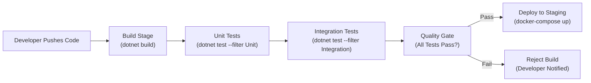
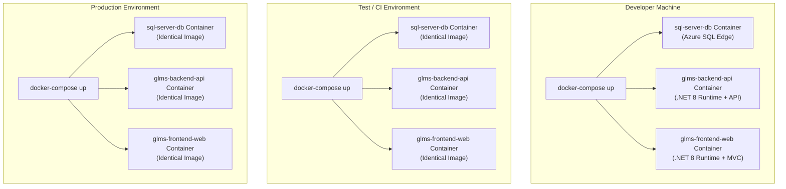

# Technical Reflection Report — DevOps, Automated Testing & Containerisation

## 1. Automated Testing in the CI/CD Pipeline

### 1.1 Why Automated Testing is Critical

In a Continuous Integration / Continuous Deployment (CI/CD) pipeline, code changes are merged frequently — often multiple times per day. Without automated testing, each merge becomes a gamble: developers must manually verify that their changes have not introduced regressions elsewhere in the system. In an enterprise logistics platform like the GLMS, where contract validation rules, currency calculations, and status workflows are interdependent, a single undetected bug could cascade into financial miscalculations or compliance violations.

Automated testing eliminates this risk by acting as a programmatic safety net that executes deterministically on every commit. The test suite verifies business logic (unit tests) and end-to-end API behaviour (integration tests) in seconds, providing immediate feedback to developers before changes reach production.

### 1.2 How Automated Testing Prevents Bugs in Production

The GLMS test suite operates at two levels:

**Unit Tests** verify isolated business logic:
- Currency conversion mathematics (USD to ZAR) is tested with known exchange rates, ensuring precision to two decimal places.
- File validation logic is tested to confirm that only PDF files are accepted, and that malicious file types (.exe) are rejected.
- Contract status workflow rules are tested to ensure that service requests cannot be created against expired or on-hold contracts.

**Integration Tests** verify the complete API request-response cycle:
- An HTTP client calls `POST /api/contracts`, then immediately calls `GET /api/contracts/{id}` to verify the data was persisted correctly (create-then-read roundtrip).
- Status code assertions confirm that the API returns `201 Created` for successful operations, `400 Bad Request` for invalid input, and `404 Not Found` for missing resources.
- Authentication tests verify that unauthenticated requests are rejected with `401 Unauthorized`.

In a CI/CD pipeline (e.g., GitHub Actions), these tests run automatically on every push:

If any test fails, the pipeline halts and the developer is notified immediately — the broken code never reaches production. This "shift-left" approach catches defects at the earliest possible stage, where they are cheapest to fix. A bug caught in automated testing costs minutes to resolve; the same bug discovered in production after affecting live freight contracts could cost thousands in remediation and lost client trust.

### 1.3 Testing and Confidence in Refactoring

The transition from a monolithic MVC application (Part 2) to a service-oriented architecture (Part 3) is a high-risk operation. The existing unit tests served as a regression safety net during refactoring — after extracting business logic from MVC controllers into the Web API, the same unit tests could be re-run to verify that the logic's behaviour remained identical. Integration tests then verified that the new API endpoints exposed the same functionality through HTTP. Without this automated verification, the refactoring would have required extensive and error-prone manual testing.

---

## 2. Containerisation with Docker

### 2.1 The "It Works on My Machine" Problem

One of the most persistent problems in software development is environmental inconsistency. A developer's local machine has specific versions of the .NET runtime, SQL Server, and operating system libraries. The staging server may have different versions. Production may differ yet again. These discrepancies cause "environment-specific" bugs — code that passes all tests locally but fails in production because of a missing dependency, a different SQL Server collation, or an incompatible runtime version.

This problem is particularly acute for the GLMS because the system comprises three distinct components (database, API, web frontend), each with its own runtime dependencies. Manually ensuring that all three components have identical configurations across development, testing, and production environments is impractical at scale.

### 2.2 How Docker Solves Environmental Consistency

Docker solves this problem by packaging each application component into a **container** — a lightweight, isolated environment that includes the application code, its runtime, and all dependencies. The container is built from a **Dockerfile**, which is a declarative specification of the exact environment:

The critical insight is that the **same Docker image** runs in every environment. The Dockerfile for the GLMS API specifies `FROM mcr.microsoft.com/dotnet/aspnet:8.0` — this exact runtime version is used whether the container runs on a developer's MacBook, a Linux CI server, or a cloud production cluster. There is no possibility of runtime version mismatch because the runtime is bundled inside the container image.

### 2.3 Docker Compose for Multi-Container Orchestration

The GLMS `docker-compose.yml` file defines the entire application ecosystem in a single declarative file:

- **sql-server-db**: The database container runs Azure SQL Edge with a persistent volume for data. The SA password and database name are injected via environment variables.
- **glms-backend-api**: The API container connects to the database using the service name `sql-server-db` as the hostname — Docker's internal DNS resolves this automatically.
- **glms-frontend-web**: The MVC container connects to the API using `http://glms-backend-api:8080` — again resolved by Docker's networking.

Running `docker-compose up` on any machine — regardless of operating system — produces an identical, fully functional GLMS instance. This eliminates hours of environment setup, resolves the "it works on my machine" problem definitively, and provides a reproducible deployment artefact that can be version-controlled alongside the application code.

### 2.4 Benefits for TechMove's Operations

For TechMove specifically, containerisation provides:

1. **Rapid Onboarding**: New developers can run the entire GLMS with a single command (`docker-compose up`) rather than spending days configuring SQL Server, .NET runtimes, and connection strings.
2. **Consistent Testing**: The CI/CD pipeline runs integration tests against the same containerised environment that will be deployed to production.
3. **Scalability**: When the 50,000-contract surge occurs, the API container can be scaled horizontally using `docker-compose up --scale glms-backend-api=3`, instantly tripling the API capacity behind a load balancer.
4. **Rollback Safety**: If a deployment introduces a bug, the previous container image can be redeployed in seconds — no need to reverse code changes or reconfigure servers.

---

## References

Docker Inc. (2024) *Docker Documentation*. Available at: https://docs.docker.com/ (Accessed: 5 March 2026).

Humble, J. and Farley, D. (2010) *Continuous Delivery: Reliable Software Releases through Build, Test, and Deployment Automation*. Upper Saddle River, NJ: Addison-Wesley.

Microsoft (2024) *ASP.NET Core Docker Documentation*. Available at: https://learn.microsoft.com/en-us/aspnet/core/host-and-deploy/docker/ (Accessed: 5 March 2026).

Fowler, M. (2006) *Continuous Integration*. Available at: https://martinfowler.com/articles/continuousIntegration.html (Accessed: 5 March 2026).
